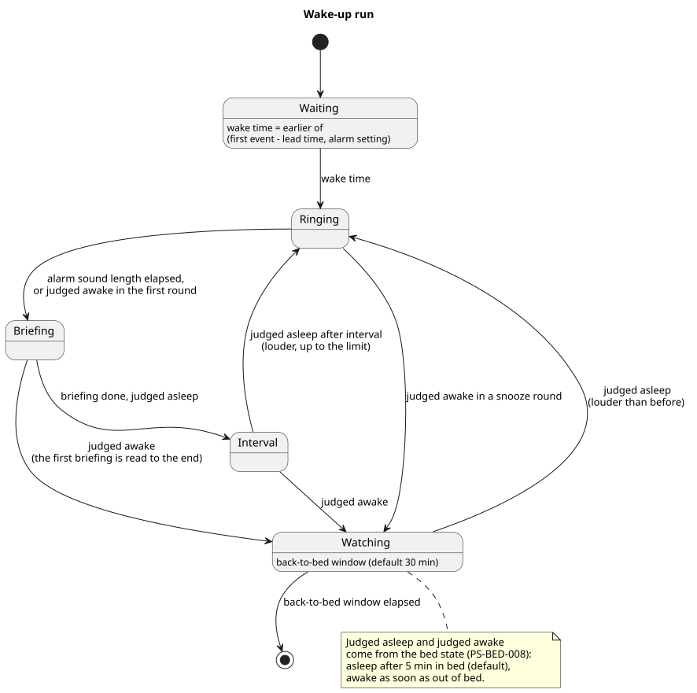

# 起床時刻とアラーム音

いつ起こすか、どう鳴らすか、起きるまでどう起こし続けるかを決める。起床の流れの始まりから終わりまでを、このカテゴリが持つ。

## 全体像

図の元ファイル: [overview.puml](overview.puml)

起床時刻は、最初の予定とアラーム設定から決まる。起床時刻にアラーム音を鳴らし、続けて予定の読み上げをする。寝ている判定のあいだはスヌーズを繰り返す。起きている判定になったあとも、二度寝を見張る時間のあいだは見張り、寝ている判定に戻ったらすぐに再び鳴らす。寝ている判定と起きている判定は、ベッド判定のカテゴリ (`PS-BED-008`) が決める。

## 要件

### アラーム設定

#### `PS-ALARM-001` 曜日ごとのアラーム設定

利用者は、曜日ごとにアラーム設定を持てる。曜日ごとに「なし」にもできる。

- 検証: `test` 曜日ごとに違うアラーム設定と「なし」を保存し、それぞれの曜日に正しい値が使われる

---

#### `PS-ALARM-002` その日だけのアラーム設定

利用者は、日付を指定して、その日だけアラーム設定を変えられる。その日だけ「なし」にもできる。その日だけの設定は、曜日ごとの設定より優先する。

- 検証: `test` その日だけの設定がある日は、曜日ごとの設定ではなく、その日だけの設定が使われる

---

#### `PS-ALARM-010` 設定ファイル

アラーム設定とそのほかの設定は、家のサーバーに置く TOML ファイルで持つ。利用者は、家のサーバーに接続してファイルを書き換えて、設定を変える。

##### `PS-ALARM-010.1` 再起動せずに反映する

ファイルを書き換えたら、press-start を再起動しなくても、次に起床時刻を決めるときから新しい設定を使う。

- 検証: `test` 動いているあいだにファイルを書き換えると、再起動せずに、次の起床時刻が新しい設定で決まる

---

##### `PS-ALARM-010.2` 読めないとき

ファイルが読めないか、書き方が間違っているときは、最後に読めた設定を使い続け、読めなかったことを記録に残す。

- 検証: `test` 書き方が間違ったファイルに書き換えても、前の設定で起床時刻が決まり、読めなかったことが記録に残る

---

### 起床時刻

#### `PS-ALARM-003` 起床時刻の決め方

起床時刻は、最初の予定とアラーム設定から決める。

##### `PS-ALARM-003.1` 早い方を選ぶ

起床時刻は、最初の予定の開始から前倒し時間を引いた時刻と、アラーム設定の、早い方とする。片方しかなければ、その片方とする。

- 検証: `test` 予定から決まる時刻とアラーム設定のどちらが早い場合も、早い方が起床時刻になる。片方しかない日は、その片方になる

---

##### `PS-ALARM-003.2` 前倒し時間

前倒し時間の既定値は10分とする。利用者は前倒し時間を変えられる。

- 検証: `test` 前倒し時間を変えると、予定から決まる時刻が変わる

---

##### `PS-ALARM-003.3` 起こさない日

対象の予定がなく、アラーム設定も「なし」の日は、アラーム音を鳴らさない。

- 検証: `test` 対象の予定もアラーム設定もない日には、起床の流れが始まらない

---

##### `PS-ALARM-003.4` 対象にしない予定

終日の予定、利用者が辞退した予定、「空き時間」と表示する予定は、対象の予定に含めない。

- 検証: `test` 終日の予定、辞退した予定、「空き時間」の予定だけがある日は、それらがない日と同じ起床時刻になる

---

##### `PS-ALARM-003.5` 読むカレンダー

設定ファイルに並べたカレンダーの予定を読む。何も並べなければ、利用者のメインのカレンダーだけを読む。

- 検証: `test` 並べたカレンダーの予定だけが対象の予定になり、何も並べないときはメインのカレンダーの予定だけが対象の予定になる

---

##### `PS-ALARM-003.6` 未明の予定

その日の3時より前に始まる予定は、対象の予定に含めない。前の晩から続く予定で、起きるための予定ではないためである。

- 検証: `test` 3時より前に始まる予定しかない日は、予定がない日と同じ起床時刻になる

---

##### `PS-ALARM-003.7` 開始時刻を大きく過ぎた予定

起床時刻を決める時点で開始時刻を1時間以上過ぎている予定は、対象の予定に含めない。予定に気づくのが大きく遅れたときに鳴らしても、役に立たないためである。

- 検証: `test` 開始時刻を1時間以上過ぎた予定しかない日は、予定がない日と同じ起床時刻になる

---

#### `PS-ALARM-004` 予定を読めないとき

Google カレンダーを読めないときは、最後に読めた予定で起床時刻を決める。最後に読めた予定もないときは、アラーム設定だけで決める。読めなかったことは記録に残す。

- 検証: `test` カレンダーへの接続が失敗しても、最後に読めた予定で起床時刻が決まり、失敗が記録に残る

---

### アラーム音

#### `PS-ALARM-005` アラーム音を鳴らす

起床時刻に、アラーム音を鳴らす。

##### `PS-ALARM-005.1` 起床時刻に始める

アラーム音は、起床時刻から1分以内に鳴らし始める。カレンダー、Withings、LLM のどれが使えなくても、アラーム音は鳴らす。

- 検証: `test` 外部のサービスがすべて応答しない状態でも、起床時刻から1分以内にアラーム音が鳴り始める

---

##### `PS-ALARM-005.2` スピーカー

アラーム音と予定の読み上げは、家のサーバーに直接つないだスピーカーで再生する。画面にログインしていなくても再生できる。

- 検証: `demo` 誰も画面にログインしていない家のサーバーで、起床時刻に音が鳴る

---

##### `PS-ALARM-005.3` 鳴らす音

利用者は、アラーム音にする音声ファイルを選べる。MP3 と WAV のファイルを選べる。

- 検証: `test` MP3 と WAV のファイルが、それぞれアラーム音として再生される

---

##### `PS-ALARM-005.4` アラーム音の長さ

アラーム音は、利用者が決めた長さだけ鳴らし、終わったらすぐに予定の読み上げに進む。長さの既定値は3分とする。

- 検証: `test` アラーム音が決めた長さで終わり、続けて予定の読み上げが始まる

---

##### `PS-ALARM-005.5` 起床時刻にベッドにいないとき

起床時刻に起きている判定なら、アラーム音も予定の読み上げも行わず、二度寝を見張る時間に入る。家にいない日に、家に残る人や動物のために音を鳴らさないためである。鳴らさなかったことは記録に残す。判定できないときは、起こし損ねないように、寝ている判定のときと同じくアラーム音を鳴らす。

- 検証: `test` 起床時刻に起きている判定なら、音が何も鳴らず、鳴らさなかったことが記録に残る
- 検証: `test` 起床時刻に判定できないときは、アラーム音が鳴る
- 検証: `test` 鳴らさなかったあと、二度寝を見張る時間のうちに寝ている判定になると、アラーム音が鳴り始める

---

##### `PS-ALARM-005.6` 音量

アラーム音と予定の読み上げは、利用者が設定ファイルで決めた音量で鳴らす。鳴らす前に、スピーカーの音量をその値にする。家のサーバーの音量が小さいままになっていても、起こし損ねないためである。スヌーズのときの音量は `PS-ALARM-006.2` が決める。

- 検証: `test` 鳴らす前に、設定ファイルで決めた音量がスピーカーに設定される
- 検証: `demo` 家のサーバーの音量を小さくしておいても、起床時刻に決めた音量で鳴る

---

##### `PS-ALARM-005.7` 起床時刻が決まった時点で過去であるとき

起床時刻が決まった時点で過去であるときは、その日の起床の流れがまだ始まっていなければ、決まってから1分以内にアラーム音を鳴らし始める。最初の予定の開始時刻をすでに過ぎていても鳴らす。ただし、開始時刻を1時間以上過ぎた予定は使わない (`PS-ALARM-003.7`)。予定が後から入ったときに、遅れてでも起こすためである。press-start の起動時点ですでに過去である起床時刻では、鳴らさない。再起動の前にその日の起床の流れが始まっていたかどうかを、再起動のあとには知る手段がないためである (`PS-ALARM-007`)。

- 検証: `test` 起床の流れがまだ始まっていない日に、決まった起床時刻がその時点で過去であれば、1分以内にアラーム音が鳴り始める
- 検証: `test` 最初の予定の開始時刻を過ぎていても、過ぎてから1時間以内であれば、1分以内にアラーム音が鳴り始める
- 検証: `test` press-start の起動時点で起床時刻が過去であれば、アラーム音は鳴らない

---

### スヌーズ

#### `PS-ALARM-006` スヌーズ

予定の読み上げのあとも、寝ている判定のあいだは起こし続ける。

##### `PS-ALARM-006.1` 繰り返す

予定の読み上げが終わってから決めた間隔が過ぎたときに寝ている判定であれば、アラーム音と予定の読み上げをもう一度行う。判定できないときは、もう一度は行わず、二度寝を見張る時間に入る。判定できない状態で鳴らし続けないためである。間隔の既定値は5分とする。

- 検証: `test` 寝ている判定のまま間隔が過ぎると、アラーム音と予定の読み上げが繰り返される
- 検証: `test` 判定できないまま間隔が過ぎると、アラーム音は鳴らず、二度寝を見張る時間に入る

---

##### `PS-ALARM-006.2` 音量を上げる

スヌーズのたびに、前回より大きい音量で鳴らす。音量は、利用者が決めた上限を超えない。

- 検証: `test` スヌーズの回ごとに音量が上がり、上限で止まる

---

##### `PS-ALARM-006.3` 起きている判定になったとき

アラーム音の途中で起きている判定になったら、アラーム音を止めて、すぐに予定の読み上げに進む。予定の読み上げは、始まったら途中で起きている判定になっても最後まで読み上げる。予定の読み上げが終わったときに起きている判定であれば、スヌーズをやめ、二度寝を見張る時間に入る。予定の読み上げのあとの間隔の途中で起きている判定になったときも、二度寝を見張る時間に入る。

- 検証: `test` アラーム音の途中で起きている判定になると、アラーム音が止まり、すぐに予定の読み上げが始まる
- 検証: `test` 予定の読み上げの途中で起きている判定になっても、読み上げが最後まで行われ、そのあとスヌーズは行われない

---

##### `PS-ALARM-006.4` 寝ている判定に戻ったとき

二度寝を見張る時間のうちに寝ている判定になったら、すぐにアラーム音を鳴らし、スヌーズを続ける。音量は、前回の続きから上げる。ベッドに戻ってすぐに出たときに鳴らさないのは、寝ている判定までの時間 (`PS-BED-008.1`) による。判定できない状態では、鳴らさない。

- 検証: `test` 二度寝を見張る時間のうちに寝ている判定になると、1分以内に、前回より大きい音量でアラーム音が鳴り始める

---

##### `PS-ALARM-006.5` 起床の流れを終える

最後に起きている判定になってから、寝ている判定に戻らないまま二度寝を見張る時間が過ぎたら、起床の流れを終える。二度寝を見張る時間の既定値は30分とし、利用者は変えられる。

- 検証: `test` 起きている判定になってから二度寝を見張る時間が過ぎると、起床の流れが終わり、そのあと寝ている判定になっても鳴らない

---

### 止める操作

#### `PS-ALARM-009` アラーム音を止める

利用者は、家のネットワークの中から HTTP の要求を送って、アラーム音を止められる。止めると、アラーム音の途中で起きている判定になったときと同じく、すぐに予定の読み上げに進む。そのあとは、ベッド判定に従う。ベッドの中から止めても、寝ている判定のままならスヌーズは続く。

- 検証: `test` 止める要求を送ると、アラーム音が止まり、すぐに予定の読み上げが始まる
- 検証: `test` 止めたあとも寝ている判定のままなら、間隔のあとにアラーム音がまた鳴る
- 検証: `inspection` 止める要求は、家のネットワークの外からは届かない

---

### 起床の流れを保つ

#### `PS-ALARM-007` 再起動しても続ける

起床の流れの途中で press-start や家のサーバーが再起動しても、起床の流れを最初からやり直さず、続きから再開する。

- 検証: `test` スヌーズの途中で再起動すると、スヌーズの回数と音量を保ったまま再開する

---

#### `PS-ALARM-008` 記録

起床の流れの出来事を、時刻と一緒に記録する。出来事は、起床時刻の決定、アラーム音と予定の読み上げの開始と終了、読み上げた文面、ベッド判定の変化、外部のサービスの失敗である。

- 検証: `inspection` 1回の起床の流れの記録から、起床時刻からベッドを出るまでの時間が読み取れる

---

## 未決事項

- 予定の時刻が昼以降の日の扱い。アラーム設定が「なし」で、最初の予定が昼過ぎの日にも、予定に合わせてアラーム音を鳴らすか
