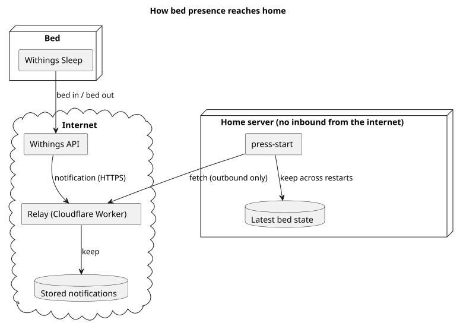

# 在床と離床

Withings Sleep が知らせる在床と離床を、どう受け取り、どう持つかを決める。追い込みは、この状態をもとに起床時刻と鳴動のカテゴリ (`PS-ALARM-006`) が行う。

## 全体像

図の元ファイル: [overview.puml](overview.puml)

Withings は、在床と離床を通知で知らせる。通知は、家の外に置いた受付が受けて溜める。家の press-start は、受付に溜まった通知を外向きに取りに行く。家のサーバーは、インターネットから接続を受けない。

## 要件

### 受け取り

#### `PS-BED-001` 在床と離床を知る

Withings Sleep の在床と離床の通知から、利用者の最新の状態 (在床か離床か) と、その時刻を知る。

- 検証: `test` 在床の通知のあとは在床、離床の通知のあとは離床になり、それぞれの時刻を持つ

---

#### `PS-BED-002` 受付

Withings の通知は、家の外に置いた受付が受ける。家の press-start は、受付から通知を取りに行く。家のサーバーは、インターネットからの接続を受けない。

- 検証: `inspection` 家のサーバーに、インターネットから届く口がない

---

#### `PS-BED-003` 家が止まっているあいだ

家の press-start が止まっていても、受付は通知を受けて溜める。家の press-start は、動き出したら溜まった通知を受け取る。

- 検証: `test` 家の press-start が止まっているあいだの通知を、動き出したあとに受け取れる

---

#### `PS-BED-004` 受付を守る

受付は、Withings からの通知だけを受け付ける。家の press-start だけが、溜まった通知を取りに行ける。

- 検証: `test` 正しい合言葉を持たない取りに行く要求を、受付が断る

---

### 状態の持ち方

#### `PS-BED-005` 再起動しても状態を失わない

press-start や家のサーバーが再起動しても、最新の状態とその時刻を失わない。

- 検証: `test` 再起動の前後で、最新の状態と時刻が同じである

---

#### `PS-BED-006` 分からないときは在床とする

状態が分からないときは、在床として扱う。分からないのは、一度も通知を受けていないときと、受付から取りに行けないときである。

- 検証: `test` 受付から取りに行けないあいだ、状態が在床として扱われる

---

#### `PS-BED-007` 購読が外れたら気付く

Withings の通知の購読が外れたら、記録に残し、購読を張り直す。

- 検証: `test` 購読がない状態を見つけると、記録に残り、購読が張り直される

---

## 未決事項

- 受付が通知を何日分溜めるか
- 受付から取りに行く間隔。起床の流れのあいだと、それ以外の時間で変えるか
