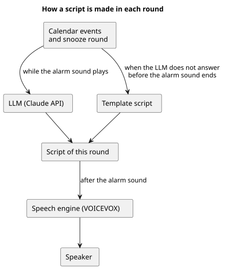

# 予定の読み上げ

予定の読み上げで何を伝えるか、文面をどう作るか、どう音声にするかを決める。

## 全体像

図の元ファイル: [overview.puml](overview.puml)

文面は、その回のアラーム音を鳴らしているあいだに LLM で作る。アラーム音が終わるまでに作れなかったときは、定型文を使う。予定の読み上げは、LLM の応答を待って遅れることがない。

## 要件

### 伝えること

#### `PS-BRIEF-001` 読み上げる内容

予定の読み上げは日本語で、これからの予定と、なぜ今起きる必要があるかを伝える。

##### `PS-BRIEF-001.1` 最初の予定

最初の予定の開始時刻と件名を伝える。

- 検証: `test` 最初の予定の開始時刻と件名が、文面に入る

---

##### `PS-BRIEF-001.2` 起きる理由

なぜ今起きる必要があるかを伝える。少なくとも、最初の予定の開始まであと何分あるかを伝える。

- 検証: `test` 最初の予定の開始までの分数が、文面に入る

---

##### `PS-BRIEF-001.3` 予定のない日

対象の予定がなく、アラーム設定で起こした日は、その日に予定がないことを伝える。

- 検証: `test` 対象の予定がない日の文面が、予定がないことを伝える

---

#### `PS-BRIEF-002` スヌーズのときの文面

スヌーズのときは、前回とは違う文面を読み上げる。回を重ねるほど、予定に間に合わなくなることを強く伝える。

- 検証: `test` スヌーズの回ごとに、違う文面が読み上げられる

---

### 文面の作り方

#### `PS-BRIEF-003` LLM で文面を作る

文面は、予定とスヌーズの回数をもとに、LLM で作る。

- 検証: `demo` 実際の予定から、LLM で作った文面が読み上げられる

---

#### `PS-BRIEF-004` 定型文に切り替える

LLM で文面を作れなかったときは、定型文を使う。作れなかったことは記録に残す。

- 検証: `test` LLM への接続が失敗すると、定型文が読み上げられ、失敗が記録に残る

---

#### `PS-BRIEF-005` アラーム音のあいだに文面を作る

文面は、その回のアラーム音を鳴らしているあいだに作る。アラーム音が終わるまでに LLM の応答がなければ、定型文を使い、予定の読み上げを遅らせない。

- 検証: `test` LLM が応答しない状態でも、アラーム音の直後に予定の読み上げが始まる

---

### 音声にする

#### `PS-BRIEF-006` 文面を音声にする

文面を日本語の音声にして、スピーカーで再生する。音声にする処理は、インターネットにつながらなくても動く。

- 検証: `test` インターネットにつながらない状態で、文面が音声になる
- 検証: `demo` 読み上げた日本語が、聞いて分かる

---

## 未決事項

- 起きる理由として、ほかに何を伝えるか (例: 移動にかかる時間、その日の予定の数)
- LLM に予定の件名と時刻を送ってよいか。送らない項目を決めるか
