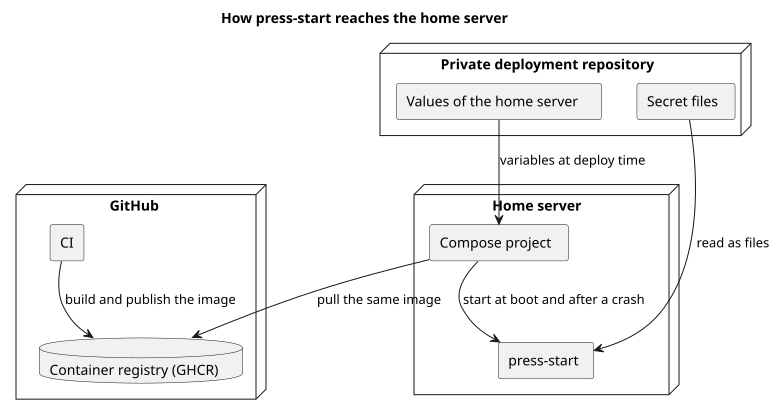

# 家のサーバーで動かす

press-start を家のサーバーにどう配り、どう動かし続けるかを決める。家のサーバーごとの値と、秘密の値の渡し方も、このカテゴリが持つ。

## 全体像

図の元ファイル: [overview.puml](overview.puml)

コンテナのイメージは CI で作って配る。リリースには、バージョンを付ける。家のサーバーは、配ったイメージを取ってきて動かし、起動したら自分で動き出す。家のサーバーごとの値と秘密の値は、このリポジトリには置かず、デプロイのときに外から渡す。

## 要件

### 配る

#### `PS-DEPLOY-001` 配ったイメージで動かす

家のサーバーは、CI で作って配ったコンテナのイメージを取ってきて動かす。家のサーバーではイメージを作らない。

- 検証: `inspection` 家のサーバーで動いているイメージが、CI で作って配ったものと同じである

---

#### `PS-DEPLOY-005` バージョンを付けてリリースする

press-start は、セマンティックバージョニングに沿ったバージョンを付けてリリースする。リリースのイメージは、そのバージョンの名前で取ってこられる。

- 検証: `inspection` バージョンの名前で取ってきたイメージが、そのコミットのために CI が作ったイメージと同じである

---

### 動かし続ける

#### `PS-DEPLOY-002` 自動で動き出す

家のサーバーが起動したら、誰も画面にログインせず、何も操作しなくても、press-start が動き出す。press-start が異常で止まったときも、自動で動き出す。

- 検証: `demo` 家のサーバーを再起動し、誰もログインしないまま、次の起床時刻にアラーム音が鳴る

---

### 外から渡す値

#### `PS-DEPLOY-003` 家のサーバーごとの値を持たない

このリポジトリは、家のサーバーごとの値を持たない。例えば、スピーカーのデバイス名、グループの ID、資源の割り当て、設定ファイルと秘密の値の置き場所である。これらの値は、デプロイのときに外から渡す。

- 検証: `inspection` リポジトリに家のサーバーごとの値がなく、外から渡した値で動く

---

#### `PS-DEPLOY-004` 秘密の値をファイルで受け取る

OAuth の token のような秘密の値は、ファイルとして受け取る。環境変数には入れない。コンテナの設定に、秘密の値が平文で残らないためである。

- 検証: `inspection` 動いているコンテナの環境変数に、秘密の値がない

---

## 未決事項

なし
