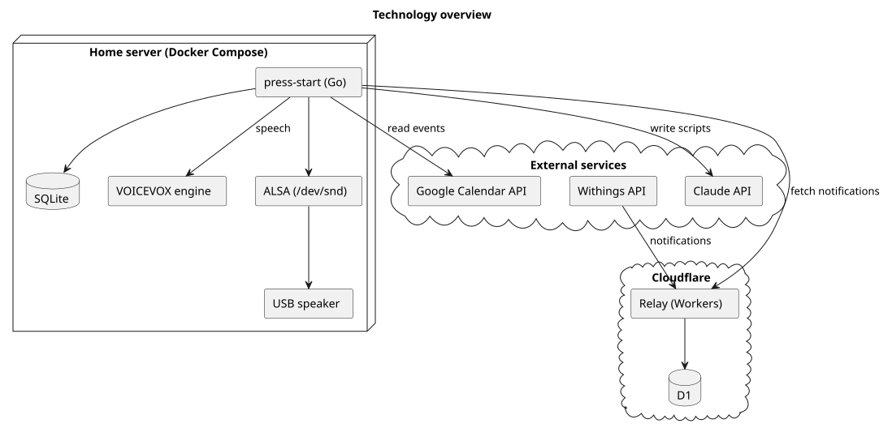

# 技術要素

press-start で使う技術と、それを選んだ理由を書く。具体的な設計は、設計文書に書く。

## 構成

図の元ファイル: [technology.puml](technology.puml)

- 家の press-start は、家のサーバーで常駐する1つのサービスである。起床時刻を決め、起床の流れを進め、音を鳴らす
- Withings 通知受信ワーカーは、家の外 (Cloudflare) に置く。Withings からの通知を受けて溜め、家の press-start が取りに来るのを待つ
- 家の press-start が外へ出す接続は、すべて家から外向きである。インターネットから家へ入る接続はない

## 使う技術

| 要素 | 技術 | 選んだ理由 |
|---|---|---|
| 家の press-start | Go (標準ライブラリを優先) | 常駐する小さなサービスに向く。1つのバイナリで配置できる |
| 状態の保存 | SQLite | 利用者1人、家のサーバー1台で、外から接続されない。再起動のあとに起床の流れとベッド判定を戻すのに十分である |
| 予定 | Google Calendar API | 予定の正本が Google カレンダーにある。読むだけの権限で足りる |
| ベッド判定 | Withings API の通知 (`appli` 50 がベッドに入った、51 がベッドを出た) | ベッド判定をすぐに知る公式の方法は通知だけである。REST での問い合わせでは、すぐには分からない |
| 通知受信ワーカー | Cloudflare Workers と D1 | 常に動いていて、家が止まっていても通知を受けられる。Withings が求める、ポート 443 の HTTPS とドメイン名を、追加の作業なしで満たす |
| 文面 | Claude API (Haiku などの小さいモデル。モデルは設定で変えられる) | 予定から自然な日本語の文面を作れる。文面は短いので、小さいモデルで足りる。API キーで呼ぶだけで使え、Claude Code の CLI やサブスクリプションのトークンの更新が要らない。使えないときは定型文に切り替える |
| 音声合成 | VOICEVOX エンジン (コンテナ) | 日本語の音声が自然で、家の中だけで動く。HTTP で文面を渡すだけで使える |
| 再生 | ALSA で直接鳴らす (コンテナに `/dev/snd` を渡す) | 画面に誰もログインしていなくても鳴らせる。PipeWire を通すと、画面にログインしたセッションに頼ることになる。実機の確認で、ALSA で直接鳴らすことも、コンテナから鳴らすこともできた |
| 動かし方 | Docker Compose | 家の press-start と VOICEVOX エンジンを1つの Compose プロジェクトにまとめられる。同じイメージがどこでも動く。コンテナは画面のログインに左右されずにスピーカーを開ける |

## ライブラリの方針

- Go の標準ライブラリを優先する。OAuth、SQLite のドライバーのように、自分で作ると危ないものや大きいものは、よく保守されたライブラリを使う
- ライブラリを足すときは、理由を Pull Request に書く
- 外部のサービスの型は、そのサービスとやりとりするパッケージの中で止め、起床の流れの規則には持ち込まない

## 決めていないこと

- アラーム設定を変える方法 ([起床時刻とアラーム音の未決事項](alarm/index.md#未決事項))
